<p align="center">
  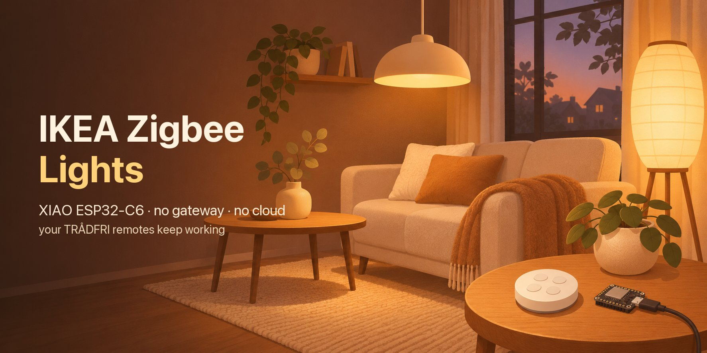
</p>

<h1 align="center">
   ikea-zigbee-esp32c6
</h1>

<p align="center">
  <b>Run your IKEA TRÅDFRI lights from a phone browser using a thumb-sized Seeed XIAO ESP32-C6.</b><br>
  You don't need the IKEA gateway, an app, a cloud account or Home Assistant. The remotes you already have keep working.
</p>

<p align="center">
  
  
  
  
  
</p>

<p align="center"><b>English</b> · <a href="docs/README.tr.md">Türkçe</a></p>

<p align="center">
  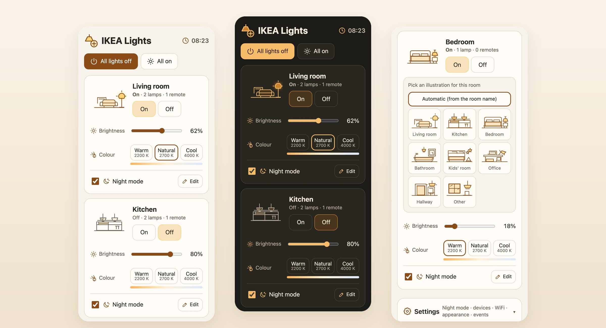
</p>

## What it is

Our flat had a 5-year-old TRÅDFRI setup with no gateway: bulbs, a square STYRBAR remote in the living room and a round remote in the kitchen. This project turns a thumb-sized **XIAO ESP32-C6** into the Zigbee coordinator for those lights. The board also serves a small, fast web page on the home WiFi at **http://ikea.local**.

- Each **room is a Zigbee group**. Lamps join the room's group when they pair.
- **Remotes are bound straight to their room's group**, so a button press goes from the remote to the lamps without passing through the ESP. If the board is unplugged, the remotes still work.
- The web page reads the lamps' own reports. When someone dims a light with a remote, the slider moves on every phone.

## Features

| | |
|---|---|
|  **Rooms at a glance** | One card per room: on/off, brightness, and colour temperature (warm 2200 K, natural 2700 K, cool 4000 K). There is also an "all lights off" button. |
|  **Room illustrations** | The ESP picks a drawing from the room name (living room, kitchen, bedroom, bathroom, kids' room, office, hallway, other) and the lamp in it glows when the room is on. Tap the drawing to choose another. The choice is saved on the board. |
|  **Night mode** | For people who forget lights on at night. Inside a time window you set per room (default 00:00–04:00), a light left on is dimmed after N minutes (default 5) to a level you choose (default 1 %). It never switches anything off. |
|  **Remotes keep working** | On/off and dimming are bound to the room group. The left/right arrow keys are bound to the ESP, which turns them into colour temperature steps for the room. |
|  **No jumping sliders** | After a command, a room shows the target value until every lamp has reported reaching it. Rooms with many LEDs don't flicker between old and new values. |
|  **Captive-portal setup** | With no WiFi saved, the board opens an open access point called `IKEA-Zigbee-Kurulum` and a setup page appears on your phone. Hold **BOOT** for 5 s to get back to it. |
|  **English and Turkish** | The page follows the browser language and can be switched in Settings. Messages from the firmware are translated in the page. Themes: follow the phone, light or dark. |
|  **Internet time** | Time comes from SNTP. The page sends the browser's time zone, including DST rules, to the board once. |
|  **One file, offline** | The page is one self-contained HTML file of about 50 KB, with no CDNs, fonts or frameworks, embedded in the firmware. |

## Screenshots

<table>
  <tr>
    <td align="center" width="33%">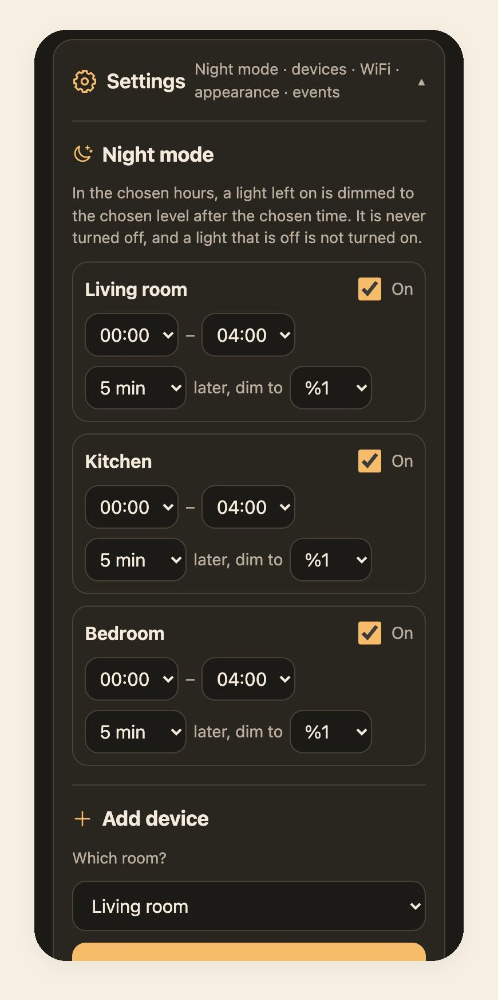<br><sub><b>Night mode per room</b>: hours, delay and level</sub></td>
    <td align="center" width="33%">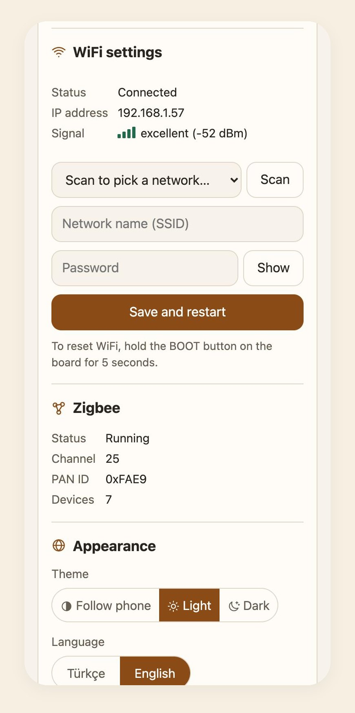<br><sub><b>Settings</b>: WiFi signal, Zigbee, theme, language</sub></td>
    <td align="center" width="33%">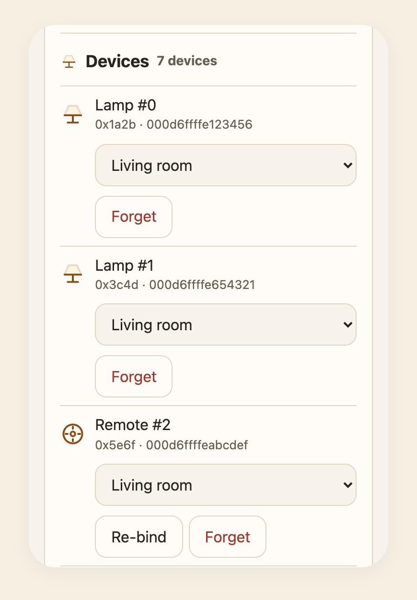<br><sub><b>Devices</b>: move between rooms, re-bind, forget</sub></td>
  </tr>
  <tr>
    <td align="center">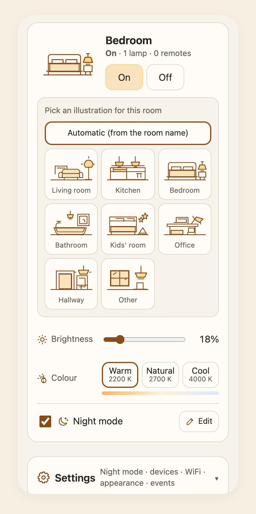<br><sub><b>Pick a drawing</b> for each room</sub></td>
    <td align="center">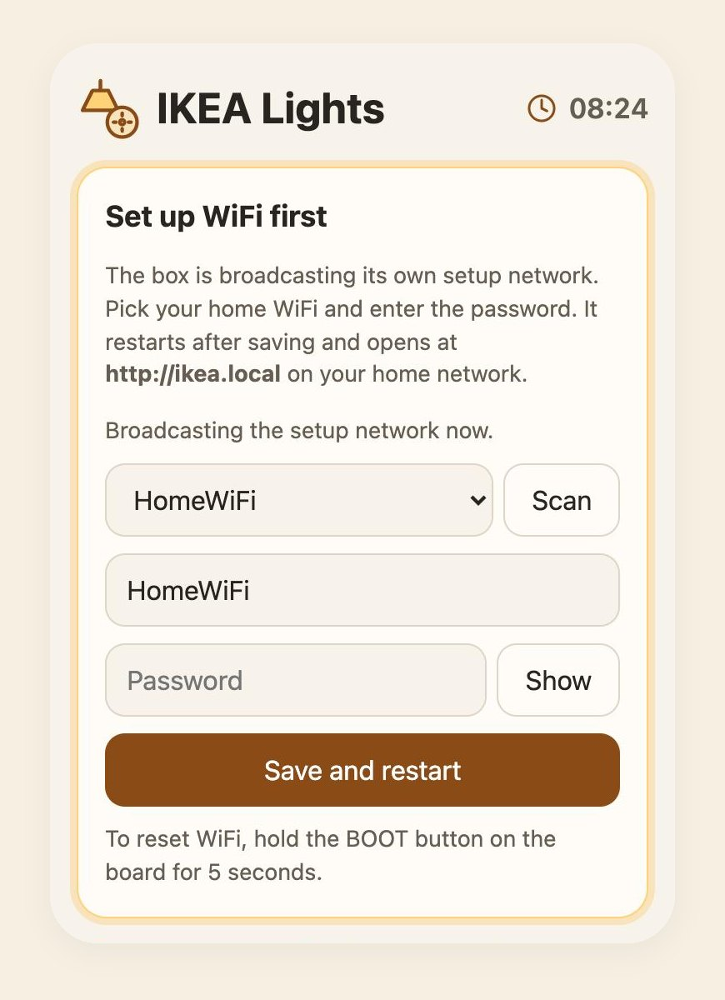<br><sub><b>First start</b>: captive-portal WiFi setup</sub></td>
    <td align="center">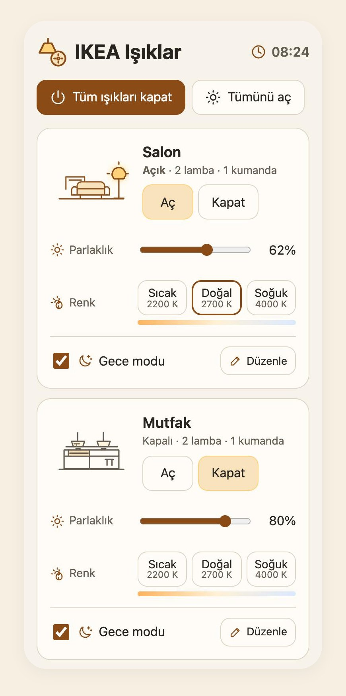<br><sub><b>Türkçe</b>: one switch in Settings</sub></td>
  </tr>
</table>

<p align="center">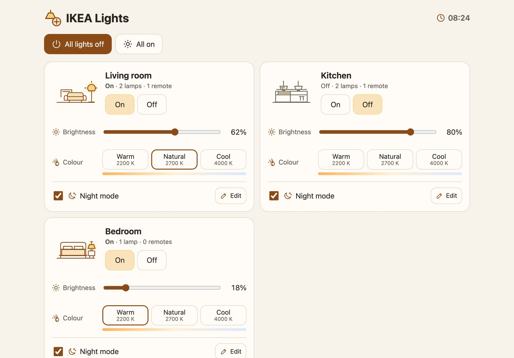<br><sub>On a laptop the rooms sit in two columns.</sub></p>

### Illustrations

Every drawing is hand-written inline SVG that follows the page theme. The lamp in each room scene glows (`.lit`) when that room is on.

|  |  |  |  |
|:--:|:--:|:--:|:--:|
| Living room | Kitchen | Bedroom | Bathroom |
|  |  |  |  |
| Kids' room | Office | Hallway | Other |

<p align="center">
  &nbsp;
  &nbsp;
  &nbsp;
  &nbsp;
  &nbsp;
  &nbsp;
  &nbsp;
  &nbsp;
  &nbsp;
  &nbsp;
  &nbsp;
  
</p>

## How it works

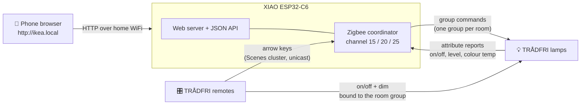

- WiFi and the 802.15.4 radio share one RF front end. The firmware enables WiFi/Zigbee coexistence and modem sleep so both stay usable. Zigbee forms its network on one of the channels 15, 20 or 25, which overlap least with 2.4 GHz WiFi.
- In setup mode (access point), Zigbee is not started, because the SoftAP and Zigbee don't share the radio reliably. The remotes keep controlling the lamps directly.
- Lamps are asked to report on/off, level and colour temperature to the coordinator (min 1 s, max 10 min). The page polls `/api/state` every 2 s.

## Hardware

| Part | Notes |
|---|---|
| [Seeed Studio XIAO ESP32-C6](https://wiki.seeedstudio.com/xiao_esp32c6_getting_started/) | Uses the on-board antenna (GPIO3 low = RF switch on, GPIO14 low = internal antenna). The yellow user LED on GPIO15 shows the status. |
| IKEA TRÅDFRI bulbs | Tested with dimmable and white-spectrum bulbs. Bulbs that only dim simply show no colour temperature. |
| IKEA remotes | Tested with the square **STYRBAR (E2002)** and the round 5-button remote **(E1810)**. |
| USB-C power | Any phone charger. |

## Getting started

### 1. Build and flash

You need [ESP-IDF v5.4](https://docs.espressif.com/projects/esp-idf/en/v5.4/esp32c6/get-started/). The Zigbee and mDNS components are downloaded by the component manager on the first build.

```bash
git clone https://github.com/melihkarakelle/ikea-zigbee-esp32c6.git
cd ikea-zigbee-esp32c6
. ~/esp/esp-idf/export.sh
idf.py set-target esp32c6
idf.py -p /dev/cu.usbmodem2101 flash monitor   # your port name will differ
```

Optional: to build your home WiFi into the firmware, copy `main/wifi_secret.example.h` to `main/wifi_secret.h` and fill it in. That file is git-ignored. Without it the board starts in setup mode.

### 2. Connect it to your WiFi

1. Power the board. The LED blinks fast (5 Hz).
2. On your phone, join the open network **IKEA-Zigbee-Kurulum**. The setup page opens by itself. If it doesn't, browse to `http://192.168.4.1`. The LED slows to 2 Hz once your phone is connected.
3. Tap **Scan**, pick your network, enter the password and tap **Save and restart**.
4. Switch the phone back to your home WiFi and open **http://ikea.local**. If `.local` names don't work on your device, look up the board called `ikea` in your router's device list.

The ESP32-C6 only joins 2.4 GHz networks.

### 3. Pair a room

> [!WARNING]
> Resetting a lamp or remote removes its old pairing. Try a single room first. To go back, use IKEA's usual method: hold the remote next to the lamp and keep its pairing button pressed.

1. Open **Settings → Add device**, pick a room or create a new one, and tap **Start pairing**. Pairing stays open for 3 minutes.
2. **Reset the lamps.** Switch them off and on at the wall **6 times**. Each lamp blinks and appears under *Joined devices*.
3. **Reset the remote.** Hold it close to the lamps and press the small pairing button on its back **4 times within 5 seconds**.
4. When the events show *Lamp … is in the room group* and *Remote arrow keys bound to the ESP*, tap **Finish**.

If a remote fails to bind (they sleep between presses), press any button on it, then tap **Re-bind** next to it in **Devices**.

## Night mode

Each room card has a **Night mode** switch and an **Edit** button. Edit jumps to the room's row under **Settings → Night mode**, where you choose:

- **Hours.** Default 00:00–04:00. Windows over midnight such as 22–06 work.
- **Delay.** 1, 2, 5, 10, 15, 30 or 60 minutes. Default 5.
- **Level.** 1, 2, 5, 10, 20, 30 or 50 %. Default 1 %.

Inside the window, a light that is on and brighter than the chosen level is faded to that level over 3 s once the delay has passed. Turning it on again or making it brighter restarts the delay. Lights that are off are never turned on. Night mode needs the internet time; the clock in the header shows `--:--` until the time is known.

## Status LED

| LED | Meaning |
|---|---|
| Solid on while **BOOT** is held | Button press seen, counting 5 s |
| Fast blink, 5 Hz | 5 s reached, WiFi is being reset, **or** setup mode is waiting for a phone |
| Blink, 2 Hz | A phone joined the setup network. In normal running: pairing is open. |
| Slow blink, 0.5 Hz | Starting up: connecting to WiFi or Zigbee starting |
| One short flash every 2 s | Connected and running |

A WiFi reset only forgets the WiFi settings. Lamps, remotes, rooms, night settings and the Zigbee network are kept. The WiFi built into the firmware isn't used after a reset, so the board stays in setup mode until you save a network.

## Web API

The page uses a small JSON API, which you can also call from scripts or other home tools.

| Request | What it does |
|---|---|
| `GET /api/state` | Network status, rooms (with live on/level/kelvin), devices, pairing state |
| `GET /api/events?after=N` | Event log entries after id N |
| `POST /api/cmd` `room=<n>&a=on\|off\|toggle\|dim\|temp&v=<value>` | `room=0` means all lamps. `dim` takes 0–100, `temp` takes Kelvin (2200–4000). |
| `POST /api/pair` `room=<n>&s=180` or `stop=1` | Opens or closes pairing for a room |
| `POST /api/device` `i=<#>&room=<n>` · `i=<#>&forget=1` · `i=<#>&arrows=1` | Moves a device, forgets it, or re-binds a remote |
| `POST /api/room` `id=<n>&name=<name>` · `id=<n>&icon=<0-8>` | Renames a room or sets its drawing (0 = automatic) |
| `POST /api/night` `id=<n>&on=1&from=0&to=4&pct=1&delay=5` | Night mode for a room. `pct` and `delay` are optional; if left out, the old values are kept. |
| `POST /api/tz` `tz=<POSIX TZ>` | Time zone, for example `GMT0BST,M3.5.0/1,M10.5.0` |
| `GET /api/scan` · `POST /api/wifi` `ssid=..&pass=..` | WiFi scan and save |

```bash
curl -X POST http://ikea.local/api/cmd -d "room=1&a=dim&v=30"
```

> [!CAUTION]
> The page has no password. Anyone on your home network can control the lights. Don't expose it to the internet.

## Working on the web page

You don't need the board to work on the page. A small mock of the API serves `main/web/index.html` with fake rooms:

```bash
python3 tools/mock_server.py          # http://127.0.0.1:8765
python3 tools/mock_server.py --ap     # the setup-mode page
```

The mock also takes demo options such as `/?theme=dark&lang=en&open=settings`, which were used for the screenshots above. After editing an SVG in `main/web/svg/`, run `python3 main/web/embed_svg.py` to embed it into `index.html`. Then rebuild the firmware.

A USB serial console is also available (`./monitor.sh`, then `help`): `pair`, `on`, `off`, `dim`, `temp`, `list`, `assign`, `ip`, `wifi`, `netreset`.

## Project layout

```
main/
  main.c          start-up, antenna switch
  zigbee.c        coordinator, room groups, remote binding, reporting, night mode
  web.c           WiFi, setup access point + captive DNS, mDNS, HTTP API, BOOT button
  led.c           status LED patterns
  clock.c         SNTP time and time zone
  events.c        event log shown on the page
  console.c       USB serial console
  web/index.html  the whole web UI (embedded into the firmware)
  web/svg/        source SVGs for the drawings and icons
  web/embed_svg.py
tools/mock_server.py
docs/             screenshots, README images, Turkish README
```

## Known limitations

- The arrow keys on IKEA remotes send an IKEA-specific Scenes command that lamps don't act on via the group. So the arrows go to the ESP and only work while it is running. On/off and dimming work without it.
- Only one coordinator can own the lamps. Pairing them here removes them from an IKEA gateway or another hub.
- Colour temperature has three presets. RGB bulbs are not handled.

## Credits

- Colour palette, room drawings, icons, logo and banner image were designed with **OpenAI Codex**.
- Firmware and web page were written with **Claude Code**.
- Built on Espressif's [esp-zigbee-sdk](https://github.com/espressif/esp-zigbee-sdk) and [ESP-IDF](https://github.com/espressif/esp-idf).

IKEA and TRÅDFRI are trademarks of Inter IKEA Systems B.V. This is an independent hobby project and is not affiliated with or endorsed by IKEA.

## License

[MIT](LICENSE) © 2026 Melih Karakelle
