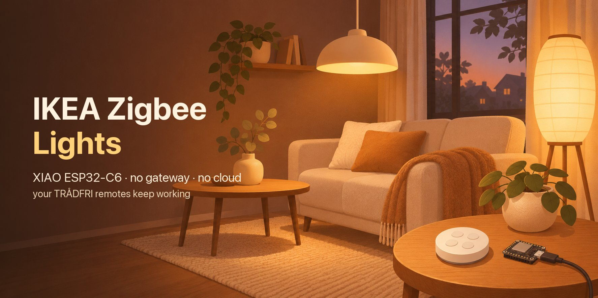
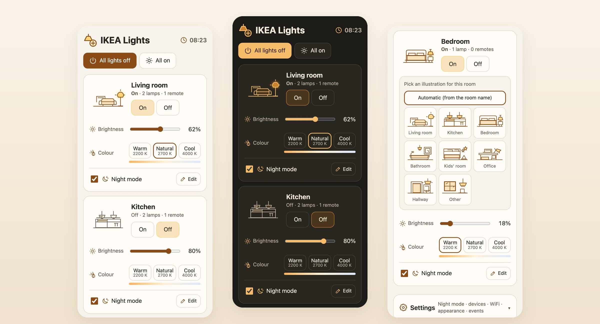
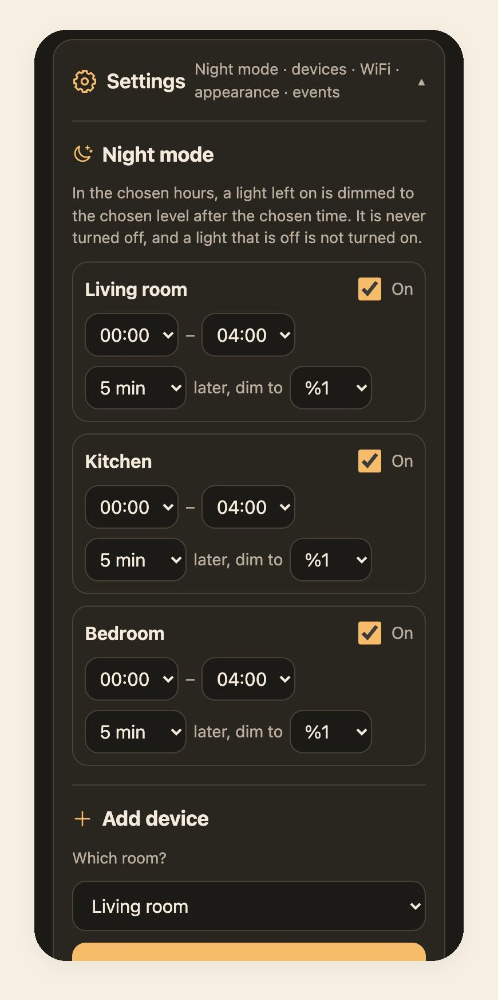
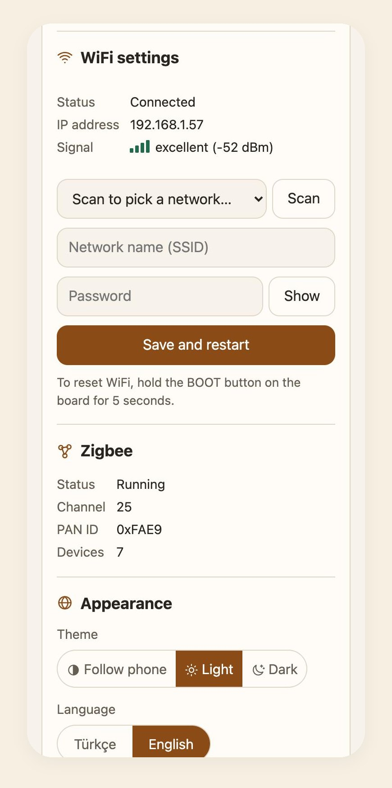
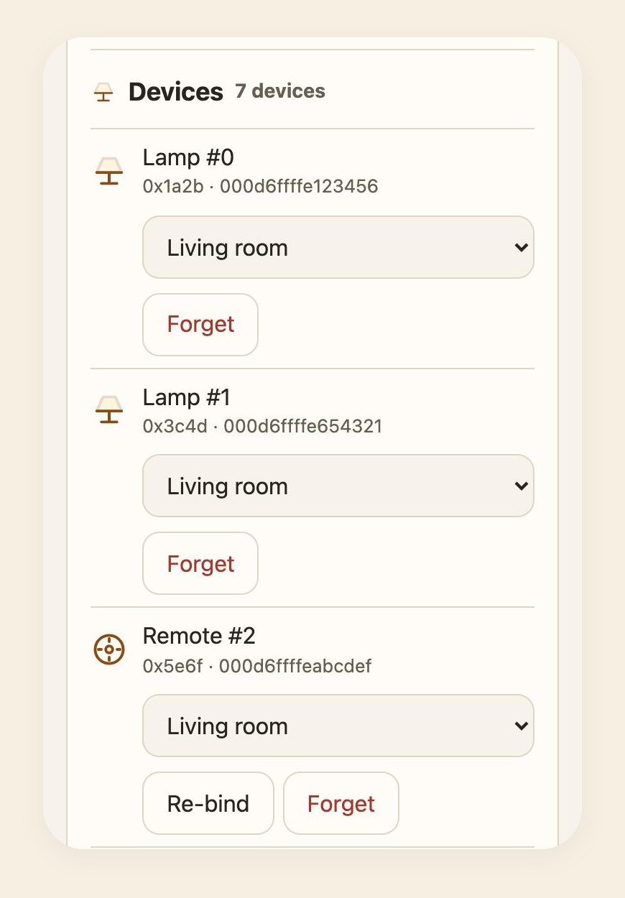
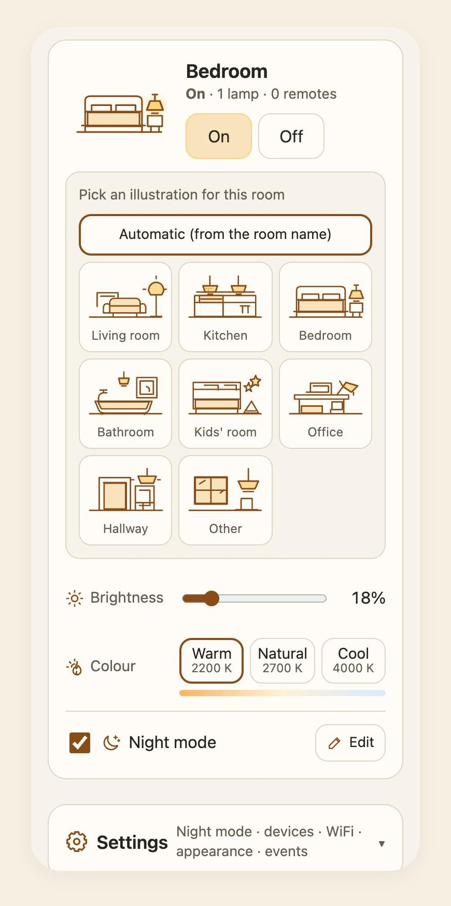
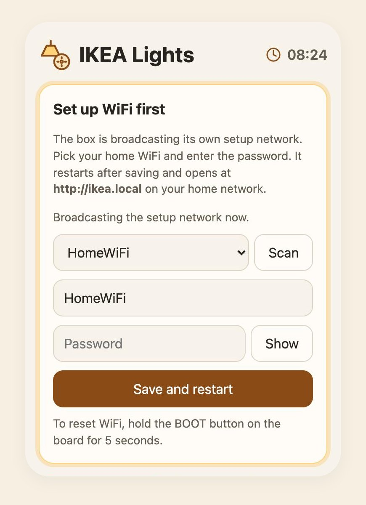
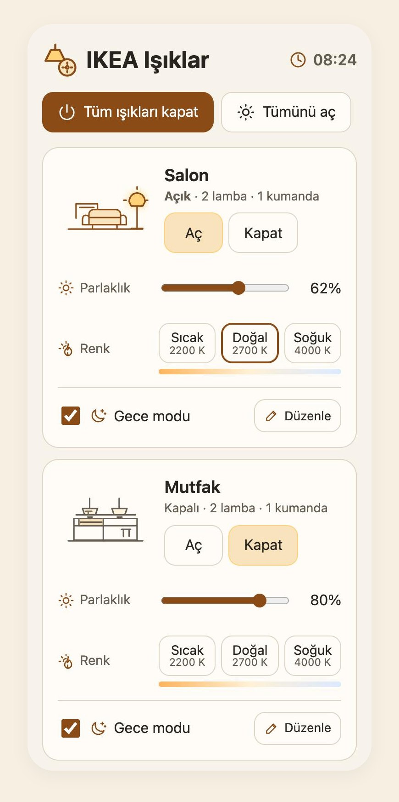
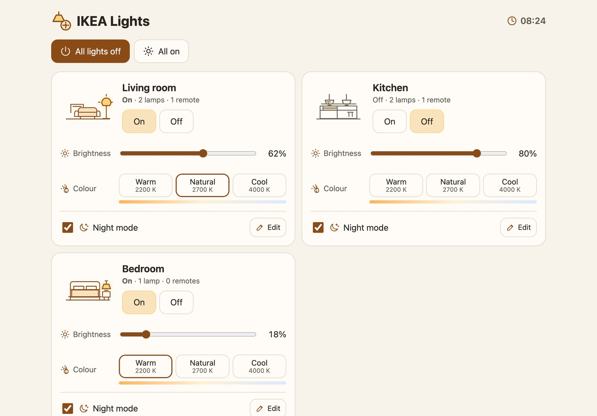
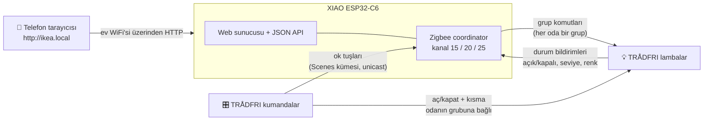

<p align="center">
  
</p>

<h1 align="center">
   ikea-zigbee-esp32c6
</h1>

<p align="center">
  <b>IKEA TRÅDFRI lambalarını parmak boyutunda bir Seeed XIAO ESP32-C6 ile telefonun tarayıcısından yönet.</b><br>
  IKEA ağ geçidi, uygulama, bulut hesabı ya da Home Assistant gerekmez. Elindeki kumandalar çalışmaya devam eder.
</p>

<p align="center">
  
  
  
  
  
</p>

<p align="center"><a href="../README.md">English</a> · <b>Türkçe</b></p>

<p align="center">
  
</p>

## Nedir

Evimizde ağ geçidi olmayan 5 yıllık bir TRÅDFRI düzeni vardı: lambalar, salonda kare STYRBAR kumanda, mutfakta yuvarlak kumanda. Bu proje parmak boyutundaki **XIAO ESP32-C6**'yı bu lambaların Zigbee coordinator'ı yapıyor. Kart aynı zamanda ev WiFi'sinde **http://ikea.local** adresinde küçük ve hızlı bir web sayfası sunuyor.

- Her **oda bir Zigbee grubudur**. Lambalar eşlenirken odanın grubuna eklenir.
- **Kumandalar doğrudan odanın grubuna bağlanır.** Tuşa basınca komut ESP'ye uğramadan kumandadan lambalara gider. Kartın fişi çekilse bile kumandalar çalışır.
- Web sayfası lambaların kendi bildirimlerini okur. Biri kumandayla ışığı kısınca kaydırıcı bütün telefonlarda kayar.

## Özellikler

| | |
|---|---|
|  **Odalar tek bakışta** | Her oda için bir kart: aç/kapat, parlaklık ve renk sıcaklığı (sıcak 2200 K, doğal 2700 K, soğuk 4000 K). Bir de "tüm ışıkları kapat" düğmesi var. |
|  **Oda çizimleri** | ESP oda adına göre bir çizim seçer (salon, mutfak, yatak odası, banyo, çocuk odası, çalışma, hol, diğer). Oda açıkken çizimdeki lamba parlar. Başka bir çizim için çizime dokun. Seçim kartta saklanır. |
|  **Gece modu** | Gece ışığı açık unutanlar için. Her oda için seçilen saatlerde (varsayılan 00:00–04:00) açık kalan ışık, N dakika sonra (varsayılan 5) seçilen seviyeye (varsayılan %1) kısılır. Hiçbir ışığı kapatmaz. |
|  **Kumandalar çalışmaya devam eder** | Aç/kapat ve kısma odanın grubuna bağlıdır. Sol/sağ ok tuşları ESP'ye bağlıdır, ESP bunları odanın renk sıcaklığını değiştiren adımlara çevirir. |
|  **Zıplamayan kaydırıcılar** | Bir komuttan sonra oda, bütün lambalar hedefe ulaştığını bildirene kadar hedef değeri gösterir. Çok LED'li odalarda değer eskiyle yeni arasında gidip gelmez. |
|  **Kurulum ağıyla kurulum** | Kayıtlı WiFi yoksa kart `IKEA-Zigbee-Kurulum` adında şifresiz bir ağ açar ve telefonda kurulum sayfası kendiliğinden açılır. Geri dönmek için **BOOT** tuşunu 5 saniye basılı tut. |
|  **Türkçe ve İngilizce** | Sayfa tarayıcının dilini izler, Ayarlar'dan değiştirilebilir. Firmware'den gelen mesajlar sayfada çevrilir. Tema: telefona göre, açık ya da koyu. |
|  **İnternetten saat** | Saat SNTP'den alınır. Sayfa tarayıcının saat dilimini, yaz saati kurallarıyla birlikte, karta bir kez gönderir. |
|  **Tek dosya, internetsiz** | Sayfa yaklaşık 50 KB'lık tek bir HTML dosyası. CDN, yazı tipi ya da framework yok, firmware'in içine gömülü. |

## Ekran görüntüleri

<table>
  <tr>
    <td align="center" width="33%"><br><sub><b>Her oda için gece modu</b>: saatler, süre, seviye</sub></td>
    <td align="center" width="33%"><br><sub><b>Ayarlar</b>: WiFi sinyali, Zigbee, tema, dil</sub></td>
    <td align="center" width="33%"><br><sub><b>Cihazlar</b>: oda değiştir, yeniden bağla, unut</sub></td>
  </tr>
  <tr>
    <td align="center"><br><sub>Her oda için <b>çizim seç</b></sub></td>
    <td align="center"><br><sub><b>İlk açılış</b>: kurulum ağından WiFi ayarı</sub></td>
    <td align="center"><br><sub><b>Türkçe</b>: Ayarlar'da tek dokunuş</sub></td>
  </tr>
</table>

<p align="center"><br><sub>Bilgisayarda odalar iki sütunda durur.</sub></p>

### Çizimler

Bütün çizimler elle yazılmış, sayfanın temasına uyan SVG'ler. Oda açıkken o odanın çizimindeki lamba parlar (`.lit`).

|  |  |  |  |
|:--:|:--:|:--:|:--:|
| Salon | Mutfak | Yatak odası | Banyo |
|  |  |  |  |
| Çocuk odası | Çalışma | Hol | Diğer |

<p align="center">
  &nbsp;
  &nbsp;
  &nbsp;
  &nbsp;
  &nbsp;
  &nbsp;
  &nbsp;
  &nbsp;
  &nbsp;
  &nbsp;
  &nbsp;
  
</p>

## Nasıl çalışır



- WiFi ve 802.15.4 radyosu tek bir RF katını paylaşır. Firmware ikisinin de kullanılabilir kalması için WiFi/Zigbee birlikte çalışmasını ve modem uykusunu açar. Zigbee ağını 2,4 GHz WiFi ile en az çakışan 15, 20 ya da 25 numaralı kanallardan birinde kurar.
- Kurulum modunda (erişim noktası) Zigbee başlatılmaz, çünkü SoftAP ve Zigbee radyoyu güvenilir şekilde paylaşamıyor. Kumandalar lambaları doğrudan kontrol etmeye devam eder.
- Lambalardan açık/kapalı, seviye ve renk sıcaklığını coordinator'a bildirmeleri istenir (en az 1 sn, en çok 10 dk arayla). Sayfa `/api/state`'i 2 saniyede bir okur.

## Donanım

| Parça | Notlar |
|---|---|
| [Seeed Studio XIAO ESP32-C6](https://wiki.seeedstudio.com/xiao_esp32c6_getting_started/) | Kart üstündeki anteni kullanır (GPIO3 low = RF anahtarı açık, GPIO14 low = dahili anten). GPIO15'teki sarı LED durumu gösterir. |
| IKEA TRÅDFRI lambalar | Kısılabilir ve beyaz tonlu lambalarla denendi. Yalnızca kısılabilen lambalarda renk sıcaklığı görünmez. |
| IKEA kumandalar | Kare **STYRBAR (E2002)** ve yuvarlak 5 tuşlu **(E1810)** kumandayla denendi. |
| USB-C güç | Herhangi bir telefon şarj aleti. |

## Başlarken

### 1. Derle ve yükle

[ESP-IDF v5.4](https://docs.espressif.com/projects/esp-idf/en/v5.4/esp32c6/get-started/) gerekli. Zigbee ve mDNS kütüphaneleri ilk derlemede component manager tarafından indirilir.

```bash
git clone https://github.com/melihkarakelle/ikea-zigbee-esp32c6.git
cd ikea-zigbee-esp32c6
. ~/esp/esp-idf/export.sh
idf.py set-target esp32c6
idf.py -p /dev/cu.usbmodem2101 flash monitor   # port adı sende farklı olabilir
```

İstersen ev WiFi'sini firmware'e gömebilirsin: `main/wifi_secret.example.h` dosyasını `main/wifi_secret.h` olarak kopyala ve doldur. Bu dosya git'e girmez. Dosya yoksa kart kurulum modunda açılır.

### 2. WiFi'ye bağla

1. Karta güç ver. LED hızlı yanıp söner (5 Hz).
2. Telefonda şifresiz **IKEA-Zigbee-Kurulum** ağına bağlan. Kurulum sayfası kendiliğinden açılır. Açılmazsa `http://192.168.4.1` adresine git. Telefon bağlanınca LED 2 Hz'e düşer.
3. **Tara**'ya bas, ağını seç, şifreyi yaz ve **Kaydet ve yeniden başlat**'a bas.
4. Telefonu ev WiFi'sine geri bağla ve **http://ikea.local** adresini aç. Cihazında `.local` adresleri açılmıyorsa modemin cihaz listesinde `ikea` adlı kartı bul.

ESP32-C6 yalnızca 2,4 GHz ağlara bağlanır.

### 3. Oda eşle

> [!WARNING]
> Sıfırlanan lamba ve kumanda eski eşleşmesini kaybeder. Önce tek bir odada dene. Geri dönmek için IKEA'nın normal yöntemi geçerli: kumandayı lambanın yanında tut ve eşleme tuşunu basılı tut.

1. **Ayarlar → Cihaz ekle**'yi aç, bir oda seç ya da yeni oda oluştur ve **Eşlemeyi başlat**'a bas. Eşleme 3 dakika açık kalır.
2. **Lambaları sıfırla.** Duvar anahtarından **6 kez** kapatıp aç. Her lamba yanıp söner ve *Katılan cihazlar* listesinde görünür.
3. **Kumandayı sıfırla.** Lambaların yakınında tut ve arkasındaki küçük eşleme tuşuna **5 saniye içinde 4 kez** bas.
4. Olaylarda *Lamba … odanın grubunda* ve *Kumandanın ok tuşları ESP'ye bağlandı* satırlarını görünce **Bitir**'e bas.

Kumanda bağlanamazsa (kumandalar tuşlar arasında uyur) bir tuşuna bas, sonra **Cihazlar**'da yanındaki **Yeniden bağla**'ya dokun.

## Gece modu

Her oda kartında bir **Gece modu** anahtarı ve **Düzenle** düğmesi var. Düzenle, **Ayarlar → Gece modu**'nda o odanın satırına götürür. Orada şunlar seçilir:

- **Saatler.** Varsayılan 00:00–04:00. 22–06 gibi gece yarısını geçen aralıklar da çalışır.
- **Süre.** 1, 2, 5, 10, 15, 30 ya da 60 dakika. Varsayılan 5.
- **Seviye.** %1, 2, 5, 10, 20, 30 ya da 50. Varsayılan %1.

Bu saatlerde açık ve seçilen seviyeden parlak bir ışık, süre dolunca 3 saniyede o seviyeye kısılır. Işığı tekrar açmak ya da parlaklığı artırmak süreyi yeniden başlatır. Kapalı ışıklar hiçbir zaman açılmaz. Gece modu için internetten saat gerekir; saat bilinene kadar üst satırdaki saat `--:--` gösterir.

## Durum LED'i

| LED | Anlamı |
|---|---|
| **BOOT** basılıyken sürekli yanar | Tuşa basıldı, 5 saniye sayılıyor |
| Hızlı yanıp söner, 5 Hz | 5 saniye doldu ve WiFi sıfırlanıyor, **ya da** kurulum modu bir telefon bekliyor |
| Yanıp söner, 2 Hz | Kurulum ağına bir telefon bağlandı. Normal çalışmada: eşleme açık. |
| Yavaş yanıp söner, 0,5 Hz | Açılış: WiFi'ye bağlanıyor ya da Zigbee başlıyor |
| 2 saniyede bir kısa çakar | Bağlı ve çalışıyor |

WiFi sıfırlaması yalnızca WiFi ayarını siler. Lambalar, kumandalar, odalar, gece modu ayarları ve Zigbee ağı yerinde kalır. Sıfırlamadan sonra firmware'e gömülü WiFi kullanılmaz; kart, bir ağ kaydedilene kadar kurulum modunda kalır.

## Web API

Sayfa küçük bir JSON API kullanır. Bu API'yi betiklerden ya da başka ev araçlarından da çağırabilirsin.

| İstek | Ne yapar |
|---|---|
| `GET /api/state` | Ağ durumu, odalar (anlık açık/seviye/kelvin), cihazlar, eşleme durumu |
| `GET /api/events?after=N` | N numaralı olaydan sonraki olaylar |
| `POST /api/cmd` `room=<n>&a=on\|off\|toggle\|dim\|temp&v=<değer>` | `room=0` tüm lambalar demek. `dim` 0–100, `temp` Kelvin (2200–4000) alır. |
| `POST /api/pair` `room=<n>&s=180` ya da `stop=1` | Bir oda için eşlemeyi açar ya da kapatır |
| `POST /api/device` `i=<#>&room=<n>` · `i=<#>&forget=1` · `i=<#>&arrows=1` | Cihazı taşır, unutur ya da kumandayı yeniden bağlar |
| `POST /api/room` `id=<n>&name=<ad>` · `id=<n>&icon=<0-8>` | Odanın adını ya da çizimini değiştirir (0 = otomatik) |
| `POST /api/night` `id=<n>&on=1&from=0&to=4&pct=1&delay=5` | Odanın gece modu. `pct` ve `delay` isteğe bağlı; verilmezse eski değerler kalır. |
| `POST /api/tz` `tz=<POSIX TZ>` | Saat dilimi, ör. `GMT0BST,M3.5.0/1,M10.5.0` |
| `GET /api/scan` · `POST /api/wifi` `ssid=..&pass=..` | WiFi tarama ve kaydetme |

```bash
curl -X POST http://ikea.local/api/cmd -d "room=1&a=dim&v=30"
```

> [!CAUTION]
> Sayfada şifre yok. Ev ağındaki herkes ışıkları kontrol edebilir. Sayfayı internete açma.

## Web sayfası üzerinde çalışmak

Sayfa üzerinde çalışmak için karta gerek yok. API'nin küçük bir taklidi `main/web/index.html`'i örnek odalarla sunar:

```bash
python3 tools/mock_server.py          # http://127.0.0.1:8765
python3 tools/mock_server.py --ap     # kurulum modu sayfası
```

Taklit sunucu `/?theme=dark&lang=tr&open=settings` gibi gösterim seçeneklerini de alır; yukarıdaki ekran görüntüleri bunlarla çekildi. `main/web/svg/` içinde bir SVG'yi değiştirince `python3 main/web/embed_svg.py` çalıştır, SVG `index.html`'e gömülür. Sonra firmware'i yeniden derle.

Ayrıca bir USB seri konsol var (`./monitor.sh`, sonra `help`): `pair`, `on`, `off`, `dim`, `temp`, `list`, `assign`, `ip`, `wifi`, `netreset`.

## Dosyalar

```
main/
  main.c          açılış, anten anahtarı
  zigbee.c        coordinator, oda grupları, kumanda bağlama, bildirimler, gece modu
  web.c           WiFi, kurulum ağı + captive DNS, mDNS, HTTP API, BOOT tuşu
  led.c           durum LED'i desenleri
  clock.c         SNTP saati ve saat dilimi
  events.c        sayfada gösterilen olay listesi
  console.c       USB seri konsol
  web/index.html  bütün web arayüzü (firmware'e gömülür)
  web/svg/        çizimlerin ve simgelerin kaynak SVG'leri
  web/embed_svg.py
tools/mock_server.py
docs/             ekran görüntüleri, README görselleri, Türkçe README
```

## Bilinen sınırlar

- IKEA kumandalarının ok tuşları IKEA'ya özel bir Scenes komutu gönderir ve lambalar bunu grup üzerinden uygulamaz. Bu yüzden ok tuşları ESP'ye gider ve yalnızca ESP açıkken çalışır. Aç/kapat ve kısma ESP olmadan da çalışır.
- Lambaları yalnızca bir coordinator yönetebilir. Lambaları burada eşlemek onları IKEA ağ geçidinden ya da başka bir merkezden çıkarır.
- Renk sıcaklığında üç hazır ayar var. RGB lambalar desteklenmiyor.

## Emeği geçenler

- Renk paleti, oda çizimleri, simgeler, logo ve banner görseli **OpenAI Codex** ile tasarlandı.
- Firmware ve web sayfası **Claude Code** ile yazıldı.
- Espressif'in [esp-zigbee-sdk](https://github.com/espressif/esp-zigbee-sdk) ve [ESP-IDF](https://github.com/espressif/esp-idf) projeleri üzerine kurulu.

IKEA ve TRÅDFRI, Inter IKEA Systems B.V.'nin ticari markalarıdır. Bu bağımsız bir hobi projesidir; IKEA ile bağlantısı yoktur ve IKEA tarafından desteklenmemektedir.

## Lisans

[MIT](../LICENSE) © 2026 Melih Karakelle
